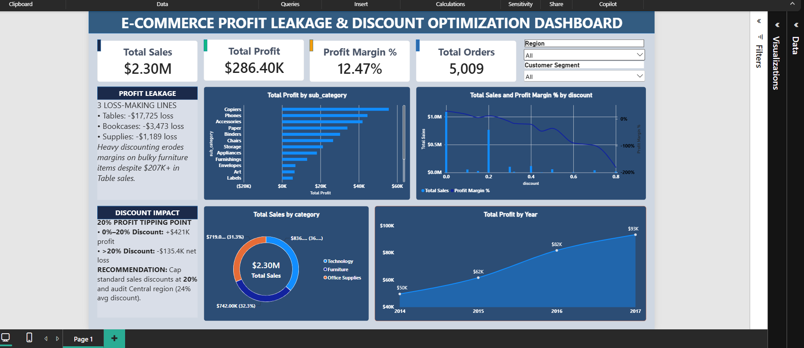

# E-Commerce Profit Leakage & Discount Optimization Analysis (Python, SQL, Power BI)

## Executive Dashboard Preview

## Business Problem
Despite generating **$2.30M in total revenue** across **5,009 unique orders**, leadership observed severe margin compression across specific product lines and sales regions. This end-to-end analysis identifies the root causes of profit leakage and establishes data-backed discount guardrails.

## Tech Stack & Pipeline
1. **Python (Pandas, Matplotlib, Seaborn):** Cleaned 9,994 transactional records (`latin1` encoding), standardized schemas into `snake_case`, engineered `shipping_days` and `profit_margin_pct`, and conducted Exploratory Data Analysis (EDA).
2. **SQL (SQLite):** Modeled the cleaned dataset into a relational `orders` table and executed corporate queries using `CASE WHEN`, `GROUP BY`, `HAVING`, Common Table Expressions (`WITH`), and `RANK()` window functions.
3. **Power BI (DAX & Interactive Reporting):** Engineered core DAX measures (`Total Sales`, `Total Profit`, `Profit Margin %`, `Total Orders`) and built an executive dashboard with regional and segment slicers.

## Key Business Findings
* **Discount Tipping Point (>20% Loss Zone):** Orders discounted between **0% and 20% generated over $421K in net profit**, whereas **discounts above 20% caused a combined net loss of -$135,376** (with 30%+ discounts turning average order profit negative).
* **Loss-Making Product Categories:** While **Copiers (+$55.6K)** and **Phones (+$44.5K)** lead profitability, three sub-categories operate at a net loss: **Tables (-$17,725)**, **Bookcases (-$3,473)**, and **Supplies (-$1,189)**.
* **Regional Margin Erosion:** The **Central region** delivered the lowest profit (**$39.7K**) despite out-selling the South region ($501K vs. $392K), driven by an average discount rate of **24%** (more than double the West region's 11%).

## Actionable Recommendations
1. **Cap Standard Discounts at 20%:** Implement automated approval workflows in CRM/ERP systems for any discount exceeding 20%, projected to recover over **$135K in leaked margin**.
2. **Re-Price or Bundle Loss-Making Furniture:** Audit supplier shipping costs and restrict promotional discounting on **Tables** and **Bookcases**.
3. **Regional Pricing Governance:** Align Central region promotional policies with West and East region benchmarks (11%–15% average discount).
